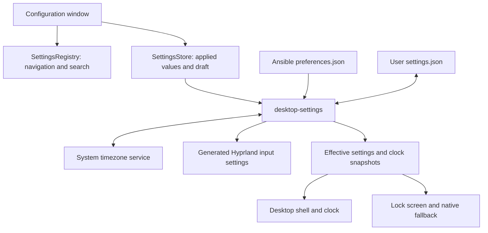

# Configuration window architecture

Status: proposed architecture, 2026-10-14. This document plans the work; runtime
implementation starts with the window framework and the General category.

The window should share the shortcut window's centered surface, rounded corners,
spacing, font and current palette. A scrollable category list occupies the left
side, with a fixed search bar above it for finding individual settings. The selected
category fills the remaining area. The first category is General.

The user confirmed that **UTC means the selected timezone's UTC offset**. Display
it as a derived value, including daylight-saving changes. This plan interprets
"placement of the lock" as **clock placement**, separately for the desktop and
lock screen. Timezone selection is proposed to change the system timezone.

## Window and navigation

```text
┌───────────────────────────────────────────────────────────────────────┐
│ Configuration                                                   Close │
├──────────────────────┬────────────────────────────────────────────────┤
│ [Search settings… ×] │ General                                      ↕ │
│ Categories         ↕ │                                                │
│ General              │ Date and time                                  │
│                      │ Timezone       [Search / select a timezone]    │
│                      │ UTC offset     UTC+02:00                       │
│                      │ Date format    [Format]   Live example         │
│                      │                                                │
│                      │ Clock placement                                │
│                      │ Desktop        [Position grid / X% / Y%]       │
│                      │ Lock screen    [Position grid / X% / Y%]       │
│                      │                                                │
│                      │ Keyboard layouts                               │
│                      │ Ordered layouts and variants                   │
│                      │ [Add layout]   [Keyboard test field]            │
├──────────────────────┴────────────────────────────────────────────────┤
│ Change status                                        Revert     Apply │
└───────────────────────────────────────────────────────────────────────┘
```

- Center on the monitor where the window opens. Keep it there until closed;
  opening it again focuses the existing window. Recenter if that monitor disappears.
- Use the shortcut window's size limits, adapting to available screen space.
  The sidebar list and category content scroll independently; the sidebar search
  bar, title, Close button and footer remain visible.
- Category changes, Apply, outside clicks and focus loss keep the window open.
  Close and Escape request closure; unsaved edits offer Apply, Discard or Stay.
  Escape first closes an open dropdown or dialog, then clears a nonempty settings
  search before requesting window closure on a subsequent press.
- Keep drafts in a shared store so changing or unloading a category preserves edits.
  Apply stays disabled while values are invalid or an operation is running.
- Coordinate focus with the existing overlays: another overlay may temporarily
  cover Configuration, and closing it returns focus to the still-open form.
  The shared frame must not impose the shortcut window's dismissal policy.
- Make General the only initial category. Additional categories register a stable
  ID, title and page component when they are implemented.
- Proposed entry points: `Super+I` and the session menu's Settings tile open
  Configuration. `Super+Comma` continues to open the compact quick settings panel.

## Settings search

- Pin a search field with the placeholder **Search settings…** and a Clear button
  above the scrollable category list. An empty query shows normal category navigation.
- Search all registered settings across categories, including pages that have not
  been loaded. Match labels, descriptions, category names and keyword aliases,
  ignoring case and extra whitespace; every query term must match. For example,
  `UTC` finds the offset and `lock clock` finds lock-screen clock placement.
- While typing, replace the sidebar list with matching settings grouped under their
  category names. Remove nonmatches immediately and show **No matching settings**
  when the result set is empty. Keep the current form available on the right.
- Clicking a result or pressing Enter opens its category, scrolls the setting into
  view and briefly highlights its row. Focus its primary control, or the row itself
  for a read-only value such as UTC offset. Keep the query and results available so
  another match can be selected; clearing the query restores the category list and
  retains the current page and draft edits.
- `Ctrl+F` focuses the search field. Up/Down selects a result while focus is in the
  search field or results; Enter activates it. Escape follows the window rules above.
  Search, result selection and navigation never apply or discard draft values.

Use a shared registry for category IDs, titles and page components, plus each
setting's stable ID, label, description and keywords. Forms and search consume the
same metadata. Each page exposes `revealSetting(settingId)` to scroll, highlight and
focus a registered setting. The window queues that request until the selected page
is ready. Search query, selected result and pending navigation are temporary UI
state, held outside the page loader and excluded from `settings.json`. New categories
register their settings as part of their implementation so search stays complete.

## General category

| Section | Controls and behavior |
| --- | --- |
| Timezone | Searchable list of installed IANA zones, with readable location names and a current-time preview. Read the active system timezone on opening; apply a changed selection through the system timezone service. |
| UTC offset | Read-only value beside the selected timezone, formatted as `UTC±HH:MM`. The draft selection updates the preview immediately. Recalculate for the current instant, including daylight-saving and fractional-hour offsets. |
| Date format | Presets for locale default, ISO date, day-first, month-first and long date, each with an example. Store a preset ID. Use the same format definition for all full-date labels; compact day/month badges keep their numeric shape. |
| Desktop clock position | A 3×3 placement selector, horizontal/vertical percentage controls and a small monitor preview. Position applies to the clock and its date caption together. |
| Lock-screen clock position | Independent controls and preview for the clock, Locked label and date caption as one group. Keep the group clear of the password toolbar. |
| Keyboard layouts | Add, remove and reorder layouts; select a variant for each entry. Show the active layout and the existing `Super+Space` switching shortcut. Include a test field for the applied layout. |

Position values use normalized coordinates from 0 to 1 over the area in which
the complete widget can fit: `left = safeLeft + x * (safeWidth - widgetWidth)`,
and similarly for `top`. Calculate bounds independently for each monitor and
scale, reserving panel and lock-control space. The first version applies one
desktop position and one lock position across monitors. Missing overrides retain
the current placement, so editing another field does not move either clock.

The desktop clock gains a full-date caption. The bar and lock-screen date labels
use the selected format as space allows. Date, time, UTC offset and image badges
must all use the same timezone and time snapshot. Python's `ZoneInfo` uses the
installed IANA database and handles daylight-saving transitions. See the
[Python timezone documentation](https://docs.python.org/3/library/zoneinfo.html).

## Components and responsibilities

| Proposed component | Responsibility |
| --- | --- |
| `CenteredWindowFrame.qml` | Shared surface geometry, theme, title, Close button and content slot. Extract styling from `ShortcutHelp.qml`; dismissal behavior is configurable for each window. |
| `ConfigurationWindow.qml` | Window lifetime, sidebar search and results, category navigation, page loader, fixed action footer and focus handling. Reveal a selected setting after its page loads. Its visibility is independent of the transient `root.page` menus. |
| `SettingsRegistry.qml` | Shared category and setting metadata, search matching and grouped results. Searching does not require loading category pages or calling the backend. |
| `GeneralSettings.qml` | The General form and previews, with stable setting IDs and `revealSetting` navigation. Reusable controls handle timezone selection, clock positioning and the ordered layout editor. |
| `SettingsStore.qml` | Applied snapshot, draft, dirty fields, field errors, category selection and asynchronous operations. It holds draft state outside the page loader. |
| `SettingsSource.qml` | Read the backend's effective settings and observe committed changes for desktop and lock consumers. It never writes user configuration. |
| `desktop-settings` | Python command interface for reading settings, catalog lookup, previews and applying changes. Requests/results are structured JSON through process stdin/stdout. |
| Shared Python settings module | Schema validation, defaults/override resolution, date formatting, timezone offsets, keyboard catalog validation and generation of compositor/lock configuration. Existing helpers reuse this module. |



## Persistence and ownership

`preferences.json` remains the Ansible-owned defaults file. Add a versioned,
user-owned `settings.json` alongside it for interactive overrides; initialize it
only when absent. Resolve built-in defaults, then Ansible defaults, then saved
overrides. Keep existing appearance data in `state.json` so theme updates cannot
overwrite General settings.

An illustrative user override file is:

```json
{
  "schemaVersion": 1,
  "revision": 1,
  "general": {
    "dateFormat": "iso-date",
    "clockPlacement": {
      "desktop": {"x": 0.0, "y": 1.0},
      "lockScreen": {"x": 0.5, "y": 0.5}
    },
    "keyboard": {
      "layouts": [
        {"layout": "us", "variant": "euro"},
        {"layout": "us", "variant": "altgr-intl"}
      ]
    }
  }
}
```

The system service owns the actual timezone; the user file does not duplicate it.
UTC offset is derived and never persisted. Generated Lua and lock files are
rebuildable outputs. Reapplying Ansible must regenerate outputs from effective
settings after installing defaults, preserving interactive overrides.

Serialize writes through the backend, use an atomic replacement for the user JSON,
and check the submitted effective revision before applying. That revision covers
the saved overrides, defaults and observed configuration, excluding clock ticks.
External changes refresh a clean
form; a dirty draft is retained and a revision conflict requires reloading or
reviewing the changed values before retrying.

## Applying and integrating settings

1. Validate the entire draft and stage generated files before changing anything.
   Validate timezone IDs against the installed catalog, finite position values,
   format IDs and layout/variant pairs against the installed XKB catalog. Require
   at least one valid layout and honor the compositor's supported layout count.
2. If the timezone changed, use `org.freedesktop.timedate1.SetTimezone` with normal
   Polkit authorization. List zones through `ListTimezones` and read `Timezone`.
   Allow the authentication dialog to receive keyboard focus; restore focus to the
   form afterward. Cancellation keeps the draft available. The session already
   runs a Polkit agent. The installed D-Bus interface and policy were inspected.
3. Generate a dedicated `settings-input.lua` from the ordered layout/variant pairs
   and include it after managed input defaults, before personal `overrides.lua`.
   Preserve unrelated input options and `Super+Space`. Validate with the existing
   native compositor parser, apply and read back the effective layout configuration.
   If personal or device configuration overrides it, report that conflict instead
   of claiming success. Preserve the active layout when it remains in the list.
4. Commit the user overrides and publish the new effective revision after successful
   application. Keep the previous files and observed values until completion.
   System calls and file writes are not one atomic transaction: on failure restore
   what can be restored, reread actual state, and report any partial outcome. Retain
   a small recovery record for interrupted application and reconcile on next start.
5. Refresh desktop placement, date text and generated clock assets immediately.
   Move current fixed formatting in `shell.qml`, `LockScreen.qml`, `lock-visuals`
   and the native Hyprlock date command onto the shared formatting contract.
   Refresh after timezone changes, clock changes and resume as well as normal ticks.
6. Render the lock settings for the next lock session, including the native fallback
   and layout labels. Keep authentication independent of the configuration UI;
   applying settings must not restart an active locker. Both locker implementations
   must consume the same effective values, with explicit coordinate conversion
   and bounds checks for the native fallback.

## Implementation sequence

1. **Window framework:** shared frame, persistent Configuration window, sidebar with
   fixed search, setting registry and result navigation, General page, draft store,
   Apply/Revert, entry points and focus behavior.
2. **Settings foundation and date/time:** schema, migration from current defaults,
   backend contract, timezone catalog/application, derived UTC offset, date presets,
   consistent previews and persistence across Ansible runs.
3. **Clock placement:** separate relative positions and previews, desktop date
   caption, monitor bounds/scaling, lock group positioning and native fallback.
4. **Keyboard layouts:** installed catalog, paired layout/variant editor, generated
   Lua, runtime verification, active-layout handling and lock-label integration.
5. **General acceptance:** validate the complete category before adding another.

Acceptance covers real keyboard/mouse navigation, independent scrolling, persistent
drafts, close behavior, both themes and small screens. Search checks cover matching
individual settings and category names, multiple terms, case differences, empty
results, clearing, keyboard selection and revealing settings on newly loaded pages.
Verify that search stays visible while the list scrolls and that searching or jumping
between results preserves drafts. Backend checks cover invalid
input, concurrent edits, denied/cancelled timezone changes, write/reload failures,
recovery and repeated Ansible application. Clock cases include midnight, DST,
half-hour/quarter-hour offsets, multiple resolutions/scales and lock-control bounds.
Keyboard cases include repeated languages with different variants, empty variants,
reordering, removal, invalid pairs and personal overrides. Complete a live Wayland
session check for Polkit focus, reload, logout/login persistence and both lock paths;
offscreen component tests alone do not establish those behaviors.
