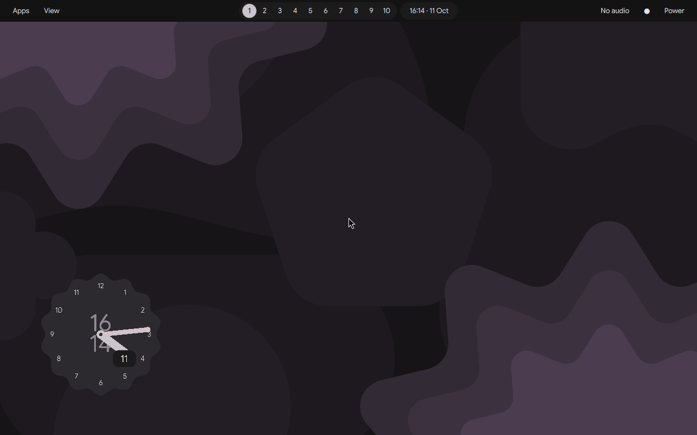
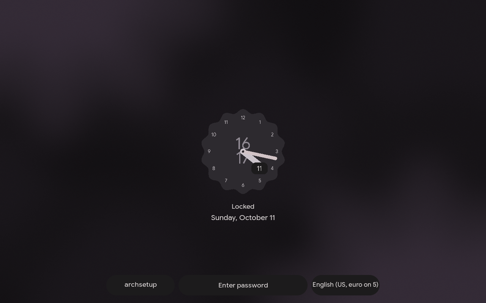

# Hyprland desktop

ArchSetup provides an opt-in desktop role and an independent Material-inspired
Quickshell configuration. It uses native Hyprland 0.56 Lua, a top taskbar,
window previews, quick settings, notification history, Fuzzel, clipboard history,
screenshots, Greetd and Hyprlock. No upstream AI source or provider integration is
included. The source reference is recorded in `desktop-source.json`.

See [validation results and remaining hardware checks](desktop-validation.md).
The VM suspend/resume check did not pass: the display remained black after wake.
Validate that path on the target machine before relying on this as its daily session.

## Install and preview

Run bootstrap first. Selecting `brave-browser.desktop` automatically installs
missing Brave using the reviewed AUR `brave-bin` revision pinned in role defaults.
Packaging runs as the regular desktop user with makepkg source checksum checks;
pacman installs the resulting package. No AUR helper or passwordless sudo is needed.
Check mode previews the build. Existing Brave installations are retained.
Other selected browsers must already be installed. Set
`archsetup_desktop_install_brave=false` to require manual Brave installation.
The pinned package is Brave 1.97.56 (AUR revision
`21e2273a1bc003bf35d00aebb40ef8c22b1a53fa`). Browser updates remain a separate
maintenance task: use your AUR update workflow; reapplying the desktop does not
upgrade an existing browser. Arch packaging is linked from
[Brave's Linux installation guide](https://brave.com/linux/#arch).
The supplied personal profile uses `brave-browser.desktop`, the existing
Quickshell provider, your input settings and DP-2/HDMI-A-1 configuration.
For a fresh machine, use the official `quickshell` package default instead of
that host-specific provider override.

```bash
./setup.sh desktop-check -e @inventory/profiles/alex-desktop.yml --ask-become-pass
./setup.sh desktop-apply -e @inventory/profiles/alex-desktop.yml --ask-become-pass
./setup.sh desktop-verify -e @inventory/profiles/alex-desktop.yml --ask-become-pass
```

An existing unmanaged Greetd configuration or profile requires explicit adoption:
add `-e archsetup_desktop_adopt=true` to the reviewed check/apply invocation.
This creates backups. By default, Greetd starts the selected user's desktop once
at boot using Hyprland's `--locked-cmd` startup lock. Hyprlock is the first password
screen; the user must have a working account password. Greetd's login screen is
the fallback after logout or session failure. Set
`archsetup_desktop_autologin_locked=false` to require Greetd authentication at boot.
Hyprlock uses `/etc/pam.d/archsetup-hyprlock`, which retains the existing Hyprlock
authentication policy and unlocks GNOME Keyring during password authentication.
The optional keyring hook starts its daemon if necessary; no password is saved
by ArchSetup. This follows [GNOME's PAM implementation](https://github.com/GNOME/gnome-keyring/blob/main/pam/gkr-pam-module.c).
Your **Login** keyring must have the same password as your account. If it differs,
change its password using Passwords and Keys (Seahorse); existing secrets are not
reset or deleted by provisioning. Fingerprint-only unlock cannot supply the
password needed to decrypt that keyring. Keyring failure does not prevent screen
unlock. Automatic login itself leaves the keyring locked until password unlock.
A competing display manager causes a preflight failure; stop it only during a
planned session transition, then disable its boot enablement before proceeding.
The role never restarts Greetd during an apply. Reboot deliberately after review,
or select **ArchSetup Hyprland** from an existing session selector.

For configuration-only deployment with an existing login manager, set
`archsetup_desktop_manage_login=false`. Start `/usr/local/bin/archsetup-session`
from a TTY after logging out of the current graphical session.

NetworkManager is enabled by default. If systemd-networkd, dhcpcd or ConnMan is
running or enabled, preflight stops before changing configuration. Preserve your
existing network service with `-e archsetup_desktop_manage_network=false`, or
migrate it separately. The opt-out leaves existing service state unchanged; it
does not undo a previous NetworkManager deployment. NetworkManager's settings
button only manages interfaces owned by NetworkManager.

For another account, supply `archsetup_desktop_enabled=true` and
`archsetup_desktop_user=ACCOUNT`. Defaults use automatic monitor discovery.
Browser choice is `archsetup_desktop_browser=ID.desktop`. The account must already
exist and have a working login password before graphical login is tested.
The role does not create users, reset passwords or install graphics drivers.

Ordinary `apply` also supports the opt-in profile. Without the enablement variable,
all desktop tasks are skipped. Package updates remain explicit: pending upgrades
in local metadata cause provisioning to stop and request `./setup.sh upgrade`.
Never use `pacman -Sy` alone. Test a full upgrade before advancing beyond the
validated Hyprland API series.

## Configuration and controls

The default appearance follows the general **ii** style with an original gradient
background, installed system typography and a 40-pixel top bar with grouped workspace/clock
controls, muted Material surfaces, thin window borders, 5-pixel outer gaps and
18-pixel window corners. A static scalloped clock sits on the desktop and updates
once per minute. Existing user-selected wallpapers and light/dark choices remain
in `state.json`; selecting the default background restores the generated gradient.

The lock screen uses the supplied sunset/anime wallpaper independently of the
desktop wallpaper. Its blue scalloped clock has dot markers, stacked hour/minute
digits, an outlined hour hand, a pink minute hand, a thin second hand, and separate
day/month badges. A background helper updates it once a second, caches font
lookups and redraws the layout pill only when its text changes. Hyprlock loads
the images asynchronously; password input never waits for image generation.
The pill reacts to [Hyprland layout events](https://wiki.hypr.land/IPC/) and requests
an immediate [Hyprlock image refresh](https://wiki.hypr.land/Hypr-Ecosystem/hyprlock/#image),
so switching layouts does not wait for the clock's one-second tick.
The helper stops when the lock screen closes. Native Hyprlock retains the existing
PAM/keyring integration, with password dots appearing immediately on each keystroke.

The bottom toolbar has a compact user/keyboard-layout pill, the password field,
and clickable **Power off** and **Reboot** buttons. Layouts such as US Euro and
US AltGr use short names; the pill's text and outline are measured together and
resize when the layout changes. Caps Lock and battery status remain visible.
Clicking **Power off** or **Reboot** changes that button to **Confirm** and the
other to **Cancel**. Confirm runs the selected action; Cancel restores both
original buttons. Each new lock starts with the original labels.
No upstream AI modules or font files are bundled. The wallpaper's
[source provenance](desktop-source.json) records the user-provided image.

Animations are enabled by default (`archsetup_desktop_reduced_motion: false`),
including the LittleArchy profile. Window opening takes 120 ms, closing and fades
80 ms, moving/resizing 100 ms, and workspace switching 140 ms. A sharp ease-out
curve avoids bounce; windows scale from 98% and workspace slides travel only 12%
of the screen. Shell surfaces use the compositor's 80–100 ms layer fades.
Hyprlock uses 100 ms fades/color effects and instant password dots; SwayNC uses 120 ms transitions and
80 ms hover effects. Set `archsetup_desktop_reduced_motion: true` to disable them.
Compositor timing follows the [Hyprland animation configuration](https://wiki.hypr.land/Configuring/Advanced-and-Cool/Animations/).
The lock setting follows the [Hyprlock animation configuration](https://wiki.hypr.land/Hypr-Ecosystem/hyprlock/#animations);
notification timing follows the [SwayNC schema](https://github.com/ErikReider/SwayNotificationCenter/blob/main/src/configSchema.json).

`~/.config/archsetup` contains the managed profile. The existing `~/.config/hypr`
is not changed. Account paths are discovered through the passwd database.
The personal profile preserves flat pointer acceleration, sensitivity zero,
keyboard layout switching on Super+Space, and the current Lua touchpad scroll
factor 0.7. Adjust `archsetup_desktop_input` if the old 0.5 value was intended.

Super+D opens applications, Super+Tab shows windows/workspaces, Super+Comma opens
quick settings, Super+N opens notification history, Super+L locks, and Super+/
shows all shortcuts. The [complete shortcut reference](desktop-shortcuts.md) lists
application aliases, relative/keypad workspace controls, window actions, zoom,
local OCR, recording, shell toggles and VM passthrough. Existing Super+D,
Super+Equal and Super+Shift+S bindings are retained; their upstream conflicts
have separate keys. Super+W launches the configured browser without passing a
URL. Moving a window to another workspace also switches to that workspace and
keeps the window focused. This applies to numbered/keypad, relative and scratch
workspace shortcuts, including the Super+Alt variants. Workspace buttons focus
workspaces and follow the active workspace's range: 1–10, 11–20, 21–30, and so on.
The taskbar shows groups of five on narrow screens and tracks each monitor
independently; the overview shows ten for its monitor. Button labels and
highlights update when switching to higher-numbered workspaces.
The taskbar groups workspaces and clock in the center, with the tray,
audio, notifications and power controls on the right. Its left side is empty.
The overview supports arrow navigation and Enter.

After a successful apply changes shell files or preferences, Ansible refreshes
the running managed Quickshell profile once and waits for it to respond again.
The bar and panels briefly restart; application windows and the login session
stay open. Unchanged applies, check mode, and users without a running shell do
not restart it. The refresh works when applying from a terminal, TTY or SSH.
An unexpected restart/startup error is reported by Ansible.

The manual recovery command is
`~/.config/archsetup/bin/desktop-action restart-shell`. Reloading Hyprland alone
does not restart the shell.

Press Super alone to open the launcher and again to close it; Super+D also toggles
the launcher. Repeat the opening shortcut to dismiss other desktop panels and
menus, including clipboard, emoji, calculator, wallpaper selection and shortcut
help. Switching between those menus replaces the current menu.

New Kitty terminals open as normal tiles and ignore client requests to maximize
or enter fullscreen. Opening another tile clears an existing maximized/fullscreen
state so the windows can share the desktop. Super+Alt+D still maximizes explicitly,
and Super+F toggles fullscreen. A single tile uses the available desktop space;
additional terminals split that space.

Kitty uses the managed desktop theme from terminal shortcuts, the application
launcher and ordinary `kitty` commands. `~/.config/kitty/kitty.conf` links to
`~/.config/archsetup/theme/kitty.conf`, which is refreshed during installation and
theme changes. An existing default Kitty configuration is backed up once to
`~/.config/kitty/kitty.conf.pre-archsetup`. Window and tab close confirmation is
disabled (`confirm_os_window_close 0`). Open a new terminal after applying changes
to load the new settings.

Network, Bluetooth and audio-device buttons open their native configuration
applications. Brightness controls are hidden without a backlight device.
Screenshot actions copy PNG data to the clipboard. Clipboard history offers an
explicit clear action. The emoji picker ships a small editable starter list.
Power actions run immediately when selected. Keep-awake inhibits idle locking/blanking,
but does not disable the before-suspend lock path.

Put images in `~/Pictures/Wallpapers`, then use Wallpaper in quick settings.
Light/dark and wallpaper choices are stored in user-owned `state.json` and survive
Ansible reruns. Wallpaper colors generate a shared accent; light/dark palettes update the shell,
Fuzzel, Kitty (new windows), notification center, window border and Hyprlock. Generated files live in
`theme/`; they are rebuilt from managed base templates and user-owned state. Lua `overrides.lua` beside `hyprland.lua` is also user-owned and loaded last.
Changing defaults should normally happen in inventory rather than managed files.

Super+Equal opens a bounded, local arithmetic calculator and copies its result.
Its overview uses live window
previews when the compositor exposes the screencopy protocol. It currently shows
all windows rather than grouping them into workspace preview cards. This overview
limitation supersedes the broader target specification in the project plan.
Launch apps through Super or Super+D, switch windows through Super+Tab and close
them with Super+Q.

## Ownership and recovery

Managed paths:

- `~/.config/archsetup/`: templates, shell, helpers and shortcut map, except
  `state.json` and `overrides.lua` which remain user-owned.
- `~/.config/kitty/kitty.conf`: link to the generated managed Kitty theme; the
  previous configuration is retained as `kitty.conf.pre-archsetup`.
- HTTP, HTTPS and HTML keys in `~/.config/mimeapps.list`; other entries are kept.
- `/usr/local/bin/archsetup-session` and
  `/usr/share/wayland-sessions/archsetup.desktop`.
- `/etc/pam.d/archsetup-hyprlock`, a separate PAM service; the existing `hyprlock`
  and `login` PAM files are retained.
- `/etc/greetd/config.toml` and ownership marker when login management is enabled.

Explicit adoption backs up an existing profile to `archsetup.pre-archsetup` once.
Ansible retains timestamped backups of changed Greetd, MIME and template files.
Save the original Greetd backup filename from apply output before rebooting.
To recover, log in on a TTY, restore that backup to `/etc/greetd/config.toml`, and
reboot deliberately. Your original Hyprland files remain available. If Greetd was
newly enabled and TTY login is preferred, use `sudo systemctl disable greetd`
from the recovery TTY before rebooting. Do not stop a display manager from inside
an unsaved desktop session. File backups do not undo a package upgrade; use a
system snapshot for stack rollback.

Lua candidates are parsed before replacing the managed compositor file; invalid
candidates leave the existing file intact.

`desktop-verify` is read-only and checks package presence, required files,
compositor parsing and login-manager enablement. It does not authenticate on your
behalf or prove suspend/resume behavior. Session processes are launched once per
Hyprland instance and cleaned up when the compositor exits. Child services restart after failure with a short delay; errors remain visible
in process logs.

## Preview






## Developer validation

With Python, Jinja2, PyYAML and Hyprland available:

```bash
python tests/desktop/test_desktop.py
python tests/desktop/render.py /tmp/archsetup-preview
Hyprland --verify-config --config /tmp/archsetup-preview/hyprland.lua
ansible-playbook playbooks/desktop.yml --syntax-check
ansible-playbook playbooks/desktop-verify.yml --syntax-check
ansible-playbook tests/desktop/disabled.yml --check
```

Use the actual Qt tool `/usr/lib/qt6/bin/qmllint` on Arch. Quickshell supplies the
PanelWindow platform implementation dynamically, so the static linter's
uncreatable-type warning needs a real Wayland runtime check. Offscreen Qt cannot
load PanelWindow and is not a substitute for a compositor test.

In a disposable graphical Arch VM: install the test browser, apply, verify, then
apply again and require `changed=0`. Modify/delete managed files, reapply, and
check repair and another unchanged run. Confirm a subsequent check-mode run has
no changes. Boot through Greetd, test password rejection/acceptance, all shell
surfaces and shortcuts, window previews, hotplug/scaling, portal screen sharing,
manual/idle lock and suspend/resume. Hardware acceptance must cover the real
mouse, DP-2 at 144 Hz and audio devices. Keep validation results distinct from
checks that still require an interactive user.
