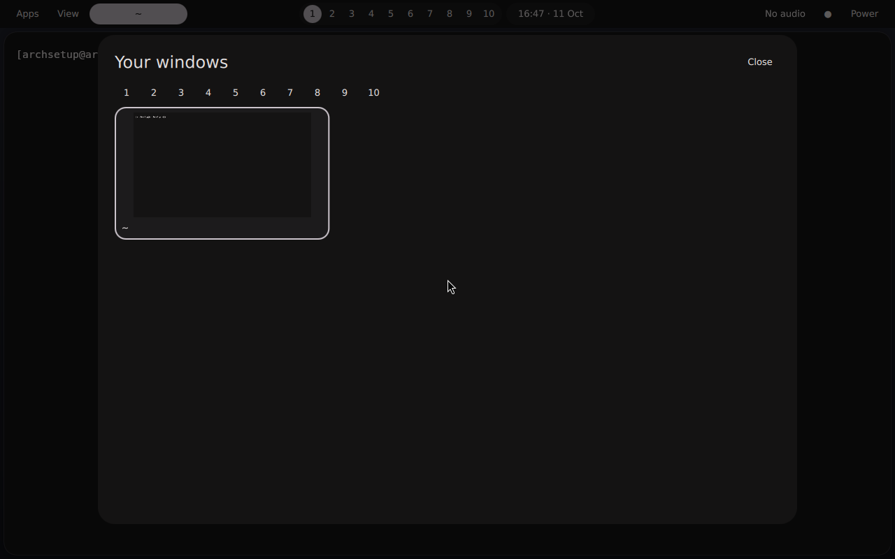

# Hyprland desktop

ArchSetup provides an opt-in desktop role and an independent Material-inspired
Quickshell configuration. It uses native Hyprland 0.56 Lua, a bottom taskbar,
window previews, quick settings, notification history, Fuzzel, clipboard history,
screenshots, Greetd and Hyprlock. No upstream AI source or provider integration is
included. The source reference is recorded in `desktop-source.json`.

See [validation results and remaining hardware checks](desktop-validation.md).
The VM suspend/resume check did not pass: the display remained black after wake.
Validate that path on the target machine before relying on this as its daily session.

## Install and preview

Run bootstrap first. Install your preferred browser from a reviewed source;
Brave is retained when present and is not downloaded from an arbitrary script.
The supplied personal profile uses `brave-browser.desktop`, the existing
Quickshell provider, your input settings and DP-2/HDMI-A-1 configuration.
For a fresh machine, use the official `quickshell` package default instead of
that host-specific provider override.

```bash
./setup.sh desktop-check -e @inventory/profiles/alex-desktop.yml --ask-become-pass
./setup.sh desktop-apply -e @inventory/profiles/alex-desktop.yml --ask-become-pass
./setup.sh desktop-verify -e @inventory/profiles/alex-desktop.yml --ask-become-pass
```

An existing unmanaged Greetd configuration or profile requires explicit adoption:
add `-e archsetup_desktop_adopt=true` to the reviewed check/apply invocation.
This creates backups. By default, Greetd starts the selected user's desktop once
at boot using Hyprland's `--locked-cmd` startup lock. Hyprlock is the first password
screen; the user must have a working account password. Greetd's login screen is
the fallback after logout or session failure. Set
`archsetup_desktop_autologin_locked=false` to require Greetd authentication at boot.
Automatic session creation does not supply a password to unlock the login keyring.
A competing display manager causes a preflight failure; stop it only during a
planned session transition, then disable its boot enablement before proceeding.
The role never restarts Greetd during an apply. Reboot deliberately after review,
or select **ArchSetup Hyprland** from an existing session selector.

For configuration-only deployment with an existing login manager, set
`archsetup_desktop_manage_login=false`. Start `/usr/local/bin/archsetup-session`
from a TTY after logging out of the current graphical session.

NetworkManager is enabled by default. If systemd-networkd, dhcpcd or ConnMan is
running or enabled, preflight stops before changing configuration. Preserve your
existing network service with `-e archsetup_desktop_manage_network=false`, or
migrate it separately. The opt-out leaves existing service state unchanged; it
does not undo a previous NetworkManager deployment. NetworkManager's settings
button only manages interfaces owned by NetworkManager.

For another account, supply `archsetup_desktop_enabled=true` and
`archsetup_desktop_user=ACCOUNT`. Defaults use automatic monitor discovery.
Browser choice is `archsetup_desktop_browser=ID.desktop`. The account must already
exist and have a working login password before graphical login is tested.
The role does not create users, reset passwords or install graphics drivers.

Ordinary `apply` also supports the opt-in profile. Without the enablement variable,
all desktop tasks are skipped. Package updates remain explicit: pending upgrades
in local metadata cause provisioning to stop and request `./setup.sh upgrade`.
Never use `pacman -Sy` alone. Test a full upgrade before advancing beyond the
validated Hyprland API series.

## Configuration and controls

Animations are disabled by default (`archsetup_desktop_reduced_motion: true`):
Hyprland window/workspace effects, Hyprlock fades and input effects, and SwayNC
transitions. The custom shell already switches its panels without animations.
The lock setting follows the [Hyprlock animation configuration](https://wiki.hypr.land/Hypr-Ecosystem/hyprlock/#animations);
notification timing follows the [SwayNC schema](https://github.com/ErikReider/SwayNotificationCenter/blob/main/src/configSchema.json).

`~/.config/archsetup` contains the managed profile. The existing `~/.config/hypr`
is not changed. Account paths are discovered through the passwd database.
The personal profile preserves flat pointer acceleration, sensitivity zero,
keyboard layout switching on Super+Space, and the current Lua touchpad scroll
factor 0.7. Adjust `archsetup_desktop_input` if the old 0.5 value was intended.

Super+D opens applications, Super+Tab shows windows/workspaces, Super+Comma opens
quick settings, Super+N opens notification history, Super+L locks, and Super+/
shows all shortcuts. Super+W launches the configured browser without passing a
URL. Workspace buttons focus workspaces; task buttons focus windows and offer a
right-click close menu. The overview supports arrow navigation and Enter.

Network, Bluetooth and audio-device buttons open their native configuration
applications. Brightness controls are hidden without a backlight device.
Screenshot actions copy PNG data to the clipboard. Clipboard history offers an
explicit clear action. The emoji picker ships a small editable starter list.
Power actions require confirmation. Keep-awake inhibits idle locking/blanking,
but does not disable the before-suspend lock path.

Put images in `~/Pictures/Wallpapers`, then use Wallpaper in quick settings.
Light/dark and wallpaper choices are stored in user-owned `state.json` and survive
Ansible reruns. Wallpaper colors generate a shared accent; light/dark palettes update the shell,
Fuzzel, Kitty (new windows), notification center, window border and Hyprlock. Generated files live in
`theme/`; they are rebuilt from managed base templates and user-owned state. Lua `overrides.lua` beside `hyprland.lua` is also user-owned and loaded last.
Changing defaults should normally happen in inventory rather than managed files.

Super+Equal opens a bounded, local arithmetic calculator and copies its result.
Its overview uses live window
previews when the compositor exposes the screencopy protocol. It currently shows
all windows rather than grouping them into workspace preview cards. Taskbar
buttons show active and urgent state; browser/files shortcuts are pinned, while
running windows have individual buttons. App-grouped pinning is not implemented. These limitations supersede the broader target specification in the
project plan; they are not claimed as complete features.

## Ownership and recovery

Managed paths:

- `~/.config/archsetup/`: templates, shell, helpers and shortcut map, except
  `state.json` and `overrides.lua` which remain user-owned.
- HTTP, HTTPS and HTML keys in `~/.config/mimeapps.list`; other entries are kept.
- `/usr/local/bin/archsetup-session` and
  `/usr/share/wayland-sessions/archsetup.desktop`.
- `/etc/greetd/config.toml` and ownership marker when login management is enabled.

Explicit adoption backs up an existing profile to `archsetup.pre-archsetup` once.
Ansible retains timestamped backups of changed Greetd, MIME and template files.
Save the original Greetd backup filename from apply output before rebooting.
To recover, log in on a TTY, restore that backup to `/etc/greetd/config.toml`, and
reboot deliberately. Your original Hyprland files remain available. If Greetd was
newly enabled and TTY login is preferred, use `sudo systemctl disable greetd`
from the recovery TTY before rebooting. Do not stop a display manager from inside
an unsaved desktop session. File backups do not undo a package upgrade; use a
system snapshot for stack rollback.

Lua candidates are parsed before replacing the managed compositor file; invalid
candidates leave the existing file intact.

`desktop-verify` is read-only and checks package presence, required files,
compositor parsing and login-manager enablement. It does not authenticate on your
behalf or prove suspend/resume behavior. Session processes are launched once per
Hyprland instance and cleaned up when the compositor exits. Child services restart after failure with a short delay; errors remain visible
in process logs.

## Preview



## Developer validation

With Python, Jinja2, PyYAML and Hyprland available:

```bash
python tests/desktop/test_desktop.py
python tests/desktop/render.py /tmp/archsetup-preview
Hyprland --verify-config --config /tmp/archsetup-preview/hyprland.lua
ansible-playbook playbooks/desktop.yml --syntax-check
ansible-playbook playbooks/desktop-verify.yml --syntax-check
ansible-playbook tests/desktop/disabled.yml --check
```

Use the actual Qt tool `/usr/lib/qt6/bin/qmllint` on Arch. Quickshell supplies the
PanelWindow platform implementation dynamically, so the static linter's
uncreatable-type warning needs a real Wayland runtime check. Offscreen Qt cannot
load PanelWindow and is not a substitute for a compositor test.

In a disposable graphical Arch VM: install the test browser, apply, verify, then
apply again and require `changed=0`. Modify/delete managed files, reapply, and
check repair and another unchanged run. Confirm a subsequent check-mode run has
no changes. Boot through Greetd, test password rejection/acceptance, all shell
surfaces and shortcuts, window previews, hotplug/scaling, portal screen sharing,
manual/idle lock and suspend/resume. Hardware acceptance must cover the real
mouse, DP-2 at 144 Hz and audio devices. Keep validation results distinct from
checks that still require an interactive user.
